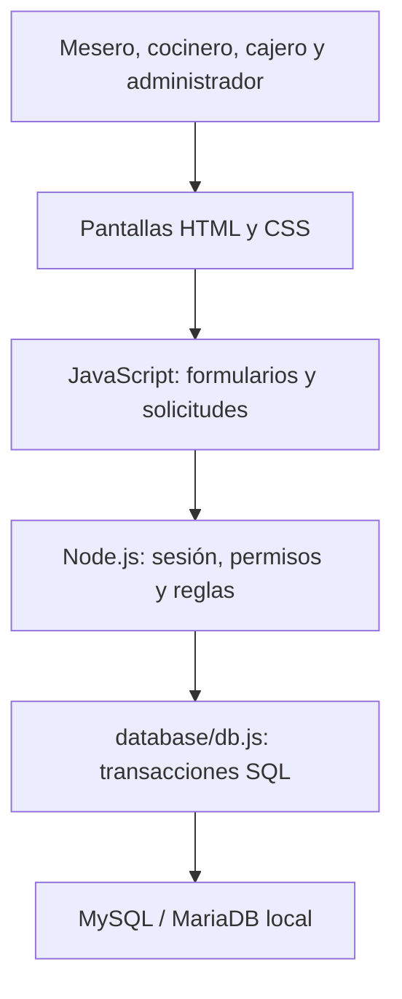
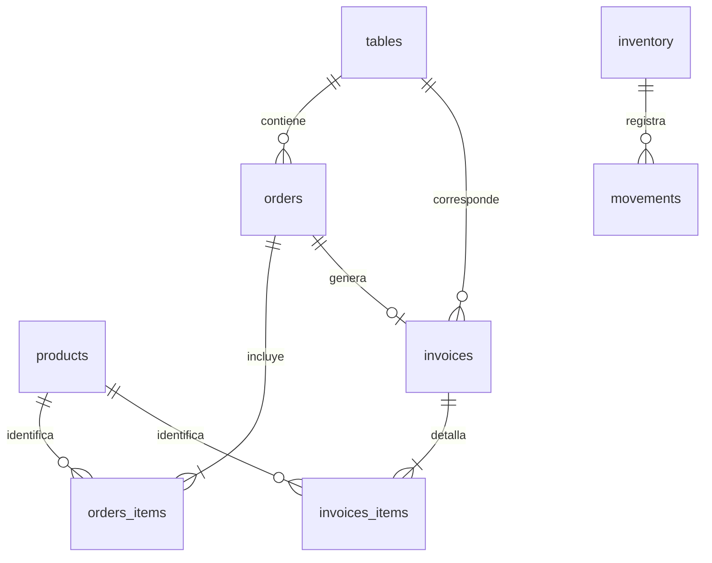
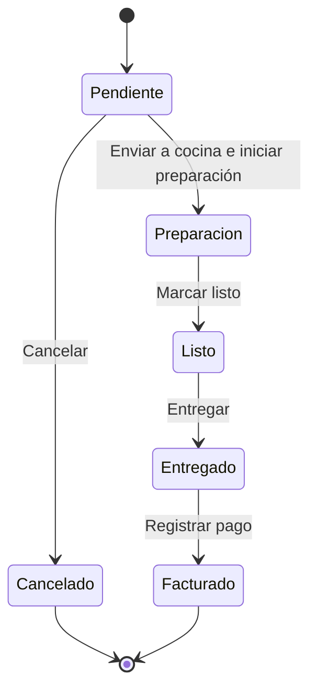

# Arquitectura y datos actualizados

## Componentes

La interfaz consulta los datos cada cinco segundos. Los cambios se confirman después del guardado SQL. La recuperación usa códigos de un uso; no hay un servidor de correo.

## Relaciones implementadas

`users` almacena las cuentas. `audit` y los movimientos conservan el nombre de usuario como referencia histórica; no tienen una clave foránea al usuario. `meta` controla la versión del estado. Las tablas del diagrama corresponden a las claves foráneas de `database/schema.sql`.

## Estados del pedido

Enviar a cocina cambia el indicador `sent` a verdadero; el estado sigue Pendiente hasta que el cocinero inicia la preparación. La edición se permite solamente antes del envío.

## Alcance incorporado de la captura

| Requisito | Implementación |
|---|---|
| RF01 Registrar usuarios | Solicitud desde login y creación por administrador. |
| RF02 Editar usuarios | Nombre, rol y activación. Identificador de usuario inmutable. |
| RF03 Eliminar usuarios | Eliminación lógica, sesiones invalidadas e historial conservado. |
| RF04 Gestionar roles | Administrador, cajero, mesero y cocinero. |
| RF05 Iniciar sesión | Usuario y contraseña, permisos en servidor. |
| RF06 Recuperar contraseña | Código propio de un uso o temporal emitido por administrador. |
| RF11 Disponibilidad de productos | Disponible/agotado, validado al crear o editar pedidos. |
| RF12–RF13 Mesas | Crear y modificar piso/capacidad por administrador. |
| RF15 Reservar mesas | Reserva básica, llegada y cancelación desde Mesas. |
| RF09 Eliminar productos | Retiro del menú, conservando el historial. |
| Solicitud adicional de inventario | Editar insumos y eliminar cuando su existencia es cero. |
| Solicitud de base de datos | MySQL/MariaDB local, tablas relacionadas e importación v3. |

Revisión ampliada con el PDF de la profesora. La reserva básica cubre RF15; la agenda completa, reportes y dashboard se mantienen para la siguiente entrega.
